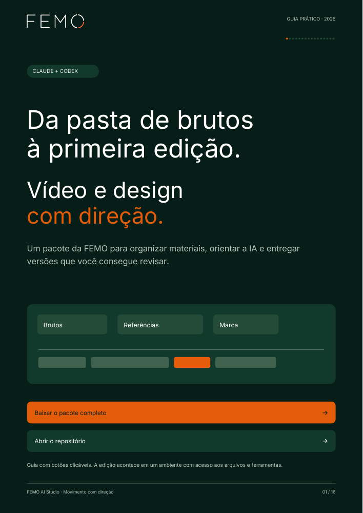

# FEMO AI Studio

**Pesquisa de clientes, estratégia, copy, design e vídeo em uma base organizada pela Agência FEMO.** Para Claude Code e Codex com acesso à pasta do trabalho e execução de ferramentas.

[Baixar o pacote](https://github.com/agenciafemo/femo-ai-studio/archive/refs/heads/main.zip) · [Guia PDF com botões](docs/GUIA-FEMO-AI-STUDIO.pdf) · [Pesquisa e fontes](docs/PESQUISA.md)

[](docs/GUIA-FEMO-AI-STUDIO.pdf)

## Novo cliente: comece por aqui

Uma entrada única coordena pesquisa de perfil, conteúdo próprio, referências, identidade visual e voz. A base reúne **19 itens do dossiê**, evidências datadas, lacunas e histórico. São **22 skills de Instagram de terceiros**, com licença e autoria preservadas, mais o método FEMO de direção e produção.

1. Baixe e extraia o pacote; abra a pasta no Claude Code ou no Codex com acesso aos arquivos.
2. Diga o nome, perfil e objetivo do cliente. Se o objetivo ainda não existe, a pesquisa ajuda a formular opções e pede a definição à equipe.
3. Peça pesquisa e dossiê. A IA usa os papéis documentados e informa o que conseguiu observar, as hipóteses e o que falta para criar.

~~~text
Leia SKILL.md. Vamos estudar [cliente], perfil [URL], com o objetivo [objetivo].
Crie ou retome a base privada desse cliente. Pesquise o perfil, conteúdo próprio,
referências de desempenho, identidade e voz com evidências.
Use agentes de pesquisa se disponíveis e autorizados, ou os mesmos papéis em sequência.
Mostre o dossiê e as lacunas específicas que nossa equipe precisa preencher.
Depois proponha pautas; aguarde a escolha antes de produzir as peças.
~~~

[Como funciona a base do cliente](docs/CLIENTES.md) · [Todas as funções reunidas](docs/CATALOGO.md) · [Método de pesquisa](references/pesquisa-e-dossie.md)

A coleta depende do navegador/conector e do acesso real ao conteúdo; login, APIs e créditos não vêm embutidos na skill. Os comandos locais organizam e verificam os dados. O repositório público contém método e modelos; bases e arquivos de clientes ficam em projetos/, ignorado pelo Git.

O PDF já disponível abaixo é a introdução original de vídeo e design. A nova camada de pesquisa está no guia de clientes acima.

## Vídeo: comece em três passos

1. **Baixe e extraia o repositório.** Abra a pasta extraída no Claude Code ou no Codex com acesso local. No primeiro uso, peça à IA para verificar as dependências.
2. **Organize brutos, referências e marca.** A IA pode criar as pastas com `python scripts/femo.py init projetos/meu-video`.
3. **Coloque o PDF no chat e peça a edição.** Se o terminal não aceitar anexos, informe o caminho do PDF e peça para ler SKILL.md. Indique onde está a pasta do trabalho.

O PDF ensina o processo; acesso aos arquivos e ferramentas permitem executá-lo. Um chat sem essas capacidades pode ajudar no roteiro e no plano, mas anexar um PDF não instala programas nem renderiza vídeos.

```text
projetos/meu-video/
  briefing.md
  01_brutos/       vídeos e áudios originais
  02_referencias/  exemplos de ritmo, corte, legenda e composição
  03_marca/        manual, logo e fontes autorizadas
  04_audio/        músicas e efeitos com direito de uso
  05_projeto/      transcrição, decisões, EDL e intermediários
  06_entregas/     prévias e versões finais
  07_design/       artes e fontes editáveis
```

## Copie este pedido

```text
Leia o guia FEMO AI Studio e o SKILL.md deste repositório.
Meu projeto está em projetos/meu-video.
Os brutos estão em 01_brutos, as referências em 02_referencias
 e a identidade visual em 03_marca.
Edite uma primeira versão de até 60 segundos, em 9:16,
com cortes naturais, fala preservada e legendas legíveis.
Verifique as ferramentas e explique qualquer dependência ausente.
Use os arquivos locais; não envie os brutos a serviços externos.
Entregue a prévia, a EDL e as legendas separadas para revisão.
```

Adapte objetivo, duração e formato. Para design, informe conteúdo, dimensões e arquivo editável desejado. Quando a skill estiver descoberta: `/femo-ai-studio` no Claude Code ou `$femo-ai-studio` no Codex.

## O que está incluído

- Skill portátil e adaptadores para as duas IAs.
- Helpers originais FEMO para pastas, diagnóstico, inventário, validação de cortes, legendas e montagem local básica.
- Referências de edição, design, identidade e integrações.
- Guia PDF com botões clicáveis e prompts prontos.
- Testes com mídia sintética e relatório de validação.

O helper faz cortes, ajuste de formato, fades curtos de áudio e legendas opcionais. Transcrição, motion, trilha e correção de cor avançada usam ferramentas adicionais. A skill orienta o agente a escolhê-las; o helper não promete implementá-las.

## Preparação

Python 3.10+ executa os helpers sem bibliotecas adicionais. FFmpeg e FFprobe são necessários para ler mídia e renderizar. HyperFrames exige Node.js 22+ e instalação própria. ASR e geração são opcionais e podem envolver downloads, conta ou créditos.

```bash
python scripts/femo.py doctor
python scripts/femo.py init projetos/meu-video
python scripts/femo.py inventory projetos/meu-video
python scripts/femo.py validate projetos/meu-video/05_projeto/edl.json
python scripts/femo.py render projetos/meu-video/05_projeto/edl.json --preview
```

`init` cria pastas, não escolhe cortes. A IA monta a EDL depois de examinar o material. Veja [o formato da EDL](references/video.md). Fora do PATH, use `FFMPEG_BIN` e `FFPROBE_BIN` para indicar os executáveis.

Para instalar a skill completa em outro projeto, sem alterar configurações globais:

```bash
python scripts/install_skill.py --target CAMINHO_DO_PROJETO --agent both
```

[Instalação e diferenças entre ambientes](docs/INSTALACAO.md) · [Pedidos prontos](docs/PROMPTS.md)

## Autoria e créditos

Direção editorial, organização do workflow, documentação e helpers deste pacote: **Agência FEMO**. Workflow independente, com referências públicas a [Video Use](https://github.com/browser-use/video-use), [HyperFrames](https://github.com/heygen-com/hyperframes), [FFmpeg](https://ffmpeg.org/) e ferramentas creditadas em [THIRD_PARTY.md](THIRD_PARTY.md). Não é um produto oficial dessas empresas nem transfere a autoria de seus motores à FEMO.

A direção FEMO vale para a comunicação da FEMO. Para clientes, use a marca de cada cliente. Fontes comerciais, manuais completos e arquivos privados não são distribuídos.

Camada de pesquisa e dossiês consolidada em 22 de outubro de 2026; pesquisa original de vídeo em 19 de outubro de 2026. Confirme versões, disponibilidade e planos na conta em uso.

## Windows e instalação de usuário

Se o comando python não estiver disponível, o launcher `scripts/femo.ps1` procura um interpretador instalado ou o runtime já disponível no Codex. Exemplo: `./scripts/femo.ps1 doctor`. Ele não muda o PATH nem a política de execução do Windows. A IA também pode usar o caminho completo do interpretador.

Para registrar a skill nos diretórios de usuário, use `python scripts/install_skill.py --user --agent both`. Isso copia a skill para os escopos pessoais do Claude Code e do Codex, sem instalar programas ou substituir uma instalação diferente.
